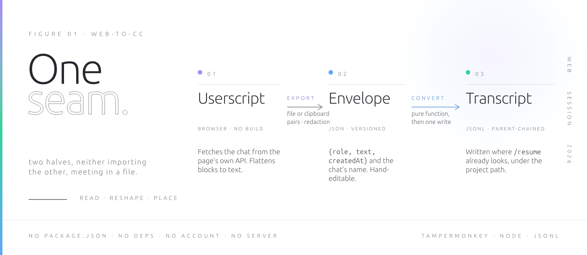
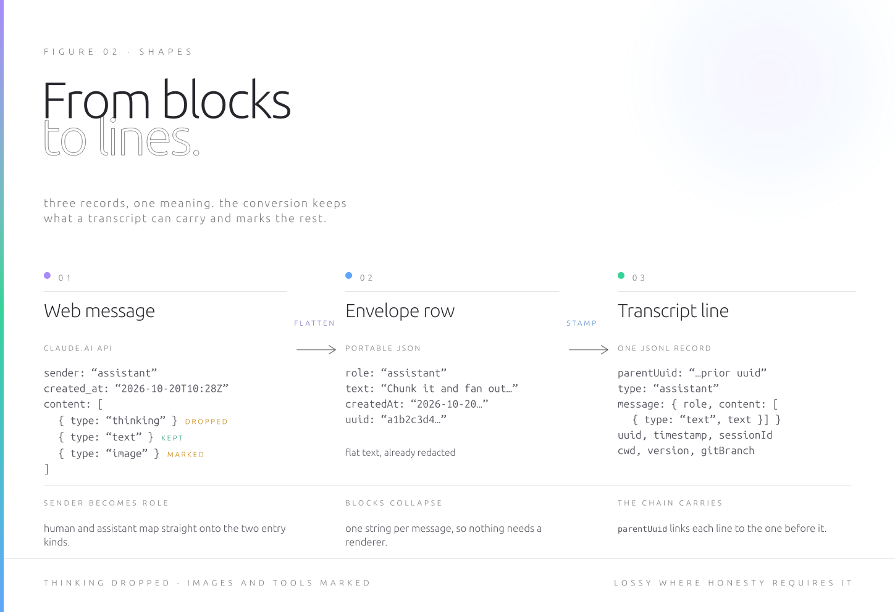
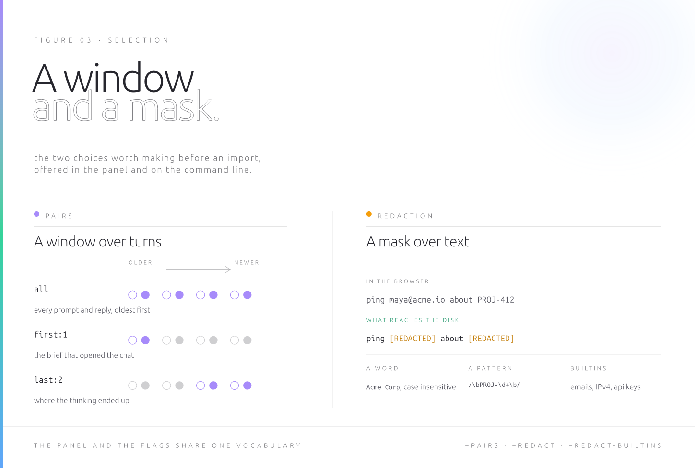
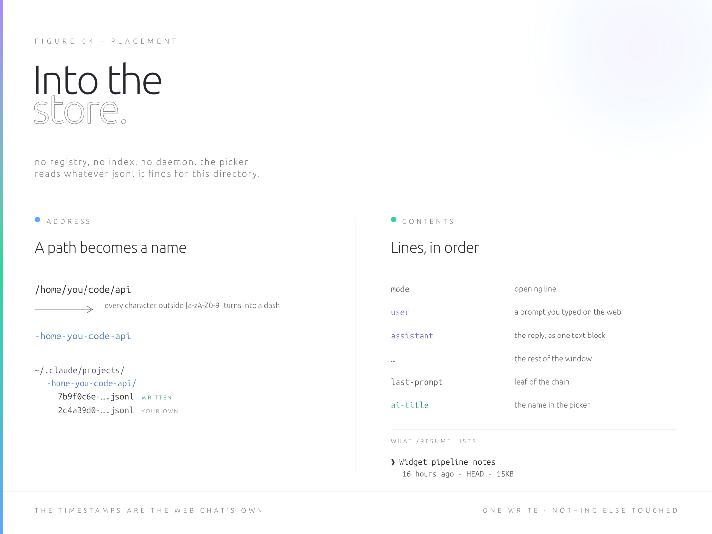
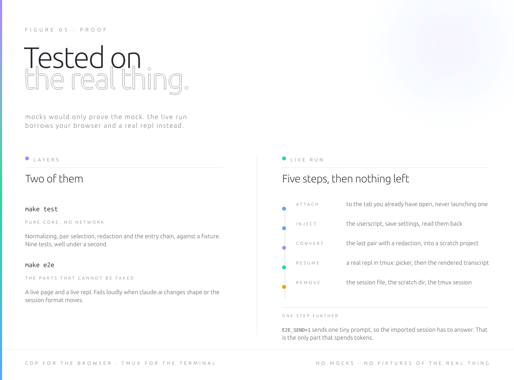

# web-to-cc

Continue a claude.ai web chat in Claude Code. A userscript exports the open
conversation as JSON, and a dependency free CLI writes it into the local session
store, so the chat appears in `/resume` as if you had had it in the terminal.



## How it works

Claude Code keeps every session as a JSONL transcript under
`~/.claude/projects/<encoded-cwd>/<session-id>.jsonl`, and `/resume` is a picker
over the files it finds there for your current directory. The whole tool rests on
that. It takes a conversation you had in the browser, rewrites it into that exact
format, and drops it in the right folder.

The browser half is a userscript you install in Tampermonkey. On a claude.ai page
it adds three menu entries: export to file, export to clipboard, and a settings
panel. When you export, it takes the conversation id out of the URL, asks
`/api/organizations` which org you are, and fetches the conversation from
claude.ai's own API with your existing cookies. Nothing is scraped out of the DOM
and nothing is sent anywhere except back to claude.ai, which your browser was
talking to anyway. Each message is flattened to plain text and the result is a
small JSON envelope: the conversation name, model and id, plus a list of
`{role, text, createdAt}`.

The CLI half reads that envelope, or a raw conversation JSON straight from the
API if you prefer to grab one yourself, and builds the transcript. Every message
becomes one JSONL line, user and assistant entries chained through `parentUuid`
the way Claude Code writes them, each stamped with the target directory, a fresh
session id, your installed Claude Code version and the original timestamps from
the web chat. A trailing title line makes the session show up under its web chat
name.

## Quick start

Install the browser half. In Tampermonkey, open the dashboard, create a new
script, and paste `web-to-cc.user.js` over the template. `make userscript` prints
the `file://` path if you would rather open it directly, which needs
Tampermonkey's access to file URLs turned on.

Install the terminal half.

```
make install            # symlink web-to-cc into ~/.local/bin
make test               # 9 unit tests, no network
```

Export a chat. Open the conversation on claude.ai, click the Tampermonkey icon,
and pick an entry.

```
Export chat -> file         download the JSON envelope
Export chat -> clipboard    same payload, no file
Export settings...          pairs, redaction patterns, replacement, defaults
```

Import it, then resume.

```
web-to-cc --in ~/Downloads/claude-web-your-chat-ab12cd34.json --cwd ~/code/api
cd ~/code/api && claude --resume <printed id>      # or just: claude, then /resume
```

## Import examples

```
# whole chat into the current directory's project
web-to-cc --in chat.json

# clipboard export, piped in
xclip -o -selection clipboard | web-to-cc --cwd ~/code/api
wl-paste | web-to-cc --cwd ~/code/api

# only the last three prompt and reply pairs
web-to-cc --in chat.json --cwd ~/code/api --pairs last:3

# only the opening pair, to carry over a brief
web-to-cc --in chat.json --pairs first:1

# mask a client name, a ticket pattern, and the builtin set
web-to-cc --in chat.json \
  --redact "Acme Corp" \
  --redact '/\bPROJ-\d+\b/' \
  --redact-builtins

# the same patterns kept in a file, one per line, # for comments
web-to-cc --in chat.json --redact-file ~/.config/web-to-cc/redactions.txt

# see what would happen, write nothing
web-to-cc --in chat.json --pairs last:2 --dry-run

# keep the transcript as an ordinary file, or read it on screen
web-to-cc --in chat.json --out ./chat-session.jsonl
web-to-cc --in chat.json --stdout | jq -c '.type' | sort | uniq -c

# fixed id for scripting, and overwrite on a rerun
web-to-cc --in chat.json --session-id 7b9f0c6e-2c3a-4f51-9a88-1d2e3f405162 --force

# keep the reasoning as plain text, retitle the session
web-to-cc --in chat.json --keep-thinking --title "API redesign brief"
```

`web-to-cc --help` lists every flag.

## What crosses over



Thinking blocks are left out, because the API only accepts them with their
original signatures and the web export has none. `--keep-thinking` puts them back
as ordinary text if you want them for reading. Images are not carried over, only
an `[image omitted: filename]` marker, so the text still says that something was
attached. Tool and artifact blocks collapse to a short `[tool: name]` marker.
What you get is the conversation as text, which is the part worth resuming.

## Pairs and redaction



Pair selection keeps only the slice you want, either everything, the first N
prompt and reply pairs, or the last N, which matters because a long web chat
makes for a heavy starting context. Redaction runs over the text with the
patterns you entered, each either a plain word or a `/regex/flags`, optionally
alongside a builtin set for email addresses, IPv4 addresses and api key shaped
strings. Masking happens in the browser, before the text reaches your disk, and
the CLI can apply a second pass with the same syntax.

## Where the session lands



The file goes to `~/.claude/projects/` plus your directory path with every non
alphanumeric character turned into a dash, which is how Claude Code addresses
projects. The command prints the exact `claude --resume <id>` line to run. From
there you get the old conversation as context and can keep going from the
terminal, with your files and tools in reach.

## Architecture

Two programs that never import each other, joined by a JSON document. The
userscript knows nothing about Claude Code, and the CLI knows nothing about
browsers. Either half is useful alone: you can export a chat and keep the JSON,
or hand write that JSON and still get a session.

Inside the CLI the split follows kinds of work rather than features.
`lib/normalize.mjs` is where foreign shapes die: the envelope, a raw conversation
JSON, or a bare array all collapse into one internal message list, and nothing
downstream knows which arrived. `lib/redact.mjs` takes text and gives back text
with a count. `lib/session.mjs` holds everything specific to Claude Code, meaning
the entry shapes, the parent chain, the project path encoding, the version stamp.
`lib/convert.mjs` composes those three into `f(chat_data, options)` and returns
the transcript, the target path and the counts without touching the disk. One
function, `putAsSession`, writes. The argv layer only parses and prints.

## Design leanings

The file is the interface. There is no plugin API here and nothing is patched.
Claude Code reads a directory of JSONL, so the tool writes a correct one and
stops.

Fidelity, then silence. Original timestamps and the chat title are kept, message
order is kept. Token counts and costs are left at zero rather than invented.
Thinking blocks are dropped instead of being forged with fake signatures, and
images leave a visible marker instead of a guess at their content. Where the
conversion cannot be honest, it declines and says so in the text.

Least authority throughout. No account, no API key, no server, no telemetry. The
browser half rides the session you are already logged into, the terminal half
performs a single local write, and it refuses to overwrite an existing session
without `--force`. `--dry-run` and `--stdout` let you look first.

## Doing this without the tool

You can get most of the value in about a minute, and the last part of the value
is what costs the afternoon.

Paste it as one prompt. Select the chat in the browser, start `claude` in your
project, and paste it under a line saying this is a conversation you had
elsewhere. This is what almost everyone does, and for a short chat it is the
right call. What you give up is structure. The whole thing arrives as a single
message from you, so your earlier answers are quoted material rather than the
assistant's own turns, and the model treats them accordingly. Selecting the last
two pairs out of thirty means scrolling and selecting by hand, and masking a
client name means editing the paste before you send it.

Pull the JSON yourself. The conversation is one authenticated GET away: open
devtools on the chat, find the `chat_conversations` request, and either copy it
as curl or run the same fetch from the console where your cookies already apply.
That takes a couple of minutes once you know the endpoint.

Then comes the tedious part. Claude Code has no import command, and `--cloud`
attaches to sessions that began on claude.ai/code rather than to a web chat. So
you write the transcript yourself, which means reverse engineering a format that
is documented only by the files already in `~/.claude/projects`. Budget half an
hour to an hour of reading your own session files for a first version that loads,
plus the quiet traps: copy the thinking blocks across and the next API call
rejects them for missing signatures, mislink one parent and the transcript
renders oddly, and a stray malformed line can make the session skip the picker.

This tool is that hour, already spent, with pair selection and redaction added
because anyone who imports chats regularly wants both.

## Developing



Node and make, and that is the whole toolchain. No package.json, no lockfile, no
bundler, no transpiler, no formatter config, no CI yet. The CLI is plain ESM and
uses only `node:` builtins. It was developed on Node 24. The parts that set a
real floor are the built in test runner and the global `WebSocket` the e2e uses
to speak CDP, so Node 22 or newer is the safe answer for development, while the
CLI alone is happy much further back. The figures under `docs/` need `typst` if
you touch them. The e2e additionally wants `tmux`, a `claude` on your PATH, and a
Chrome started with `--remote-debugging-port`, which defaults to 9555 and is
overridable with `CDP_PORT`.

```
make help     what follows
make test     unit tests
make e2e      the live run
make figs     rebuild docs figures
make install  symlink into ~/.local/bin
```

`make test` is the one to run constantly. It is offline, deterministic and takes
under a second. It covers the pure core against `test/fixtures/raw-conversation.json`:
shape normalizing, thinking and image handling, pair selection, redaction of
words, regexes and builtins, the parent chain, the path encoding, the refusal to
overwrite, and the rejection of unreadable input.

`make e2e` borrows a claude.ai chat you already have open. It never launches a
browser, and it deletes the session file, the scratch project and the tmux
session it created. Set `E2E_KEEP=1` when a failure needs picking apart, and
`E2E_SEND=1` when you want the stronger assertion that the imported session can
actually answer, which is the only part that spends tokens.

Nothing in the unit layer can tell you that claude.ai still returns what it
returned yesterday, or that Claude Code still reads transcripts the way it did
last release. Those two risks live in the e2e. Treat a failing e2e as news about
the outside world before suspecting your patch. There is no byte for byte
snapshot of a generated transcript on purpose, since pinning it would lock in a
format that belongs to someone else.

### House rules

Dependencies stay at zero. If something genuinely cannot be written in a few
lines, zod is the one allowance, and it should arrive with an argument.

Nothing leaves the machine. The userscript talks to claude.ai with the cookies
the browser already has, the CLI performs one local write, and neither handles
credentials, uploads anything or phones home. A patch that adds a network call to
anywhere else will not be welcome, and the same goes for telemetry. Keep the
userscript grants minimal: the current four exist for menu entries, clipboard and
storage, and each new one needs a reason.

Redaction stays early. Anything that defers masking until after text has been
written to disk defeats the point of having it.

Code reads like the code around it: small pure functions, one responsibility per
module, no comment essays, options named identically in the settings panel and on
the command line.

### Where to change what

A new input shape goes in `lib/normalize.mjs`, with a fixture and a test, and
nothing downstream should learn about it. A new builtin mask goes in
`lib/redact.mjs` and in the mirrored list near the top of the userscript. That
mirror is the single deliberate duplication in the project, since a userscript
cannot import from the CLI, so keep the two in step. Transcript shape lives in
`lib/session.mjs`. A new flag touches the usage text and the parser in
`web-to-cc.mjs`, plus the panel if it belongs there too. The `version` field in
the envelope is the compatibility contract between the halves, so bump it when
the shape changes and teach the normalizer to read both.

### Methodology, such as it is

The session format is not documented anywhere. It was derived by reading real
transcripts in `~/.claude/projects` and copying what the live client writes,
which is also how you should verify a change: generate a session, resume it, and
compare your lines against a session Claude Code wrote itself for the same
directory. The e2e is the standing version of that ritual.

Two findings from that process are worth keeping in mind before you edit
`session.mjs`. Thinking blocks need their original signatures or the next API
call rejects the conversation. Usage and cost fields are written as zeros rather
than estimates, because a plausible invented number is worse than an obvious
empty one.

Before a pull request: `make test`, then `make e2e` at least once, and say in the
description which Claude Code version you ran it against, since that is the
moving part.

## Disclaimer

An unofficial community tool, neither endorsed by nor supported by Anthropic.
Claude, Claude Code and claude.ai are Anthropic's names and appear here only to
say what this interoperates with.

It rests on a private web endpoint and on a local session format that is
documented only by the files Claude Code writes. Both can change without notice.
When they do, this breaks.

What you export, and where you then put it, is your call, under your account
terms and whatever policy your organization has. The conversation leaves the
browser as ordinary local text, so read it before you share it.

Provided as is, under the MIT license, without warranty of any kind and without
liability for anything that follows from its use.

## License and citation

Copyright (c) 2026 Aesthetic Vulpes ([github.com/didvc](https://github.com/didvc)).

Code and configuration samples are under the MIT license, in [LICENSE](LICENSE).
Prose, figures and documentation are under Creative Commons Attribution 4.0
International, in [LICENSE-CC](LICENSE-CC).

If you reference this work, citation metadata is in [CITATION.cff](CITATION.cff).
